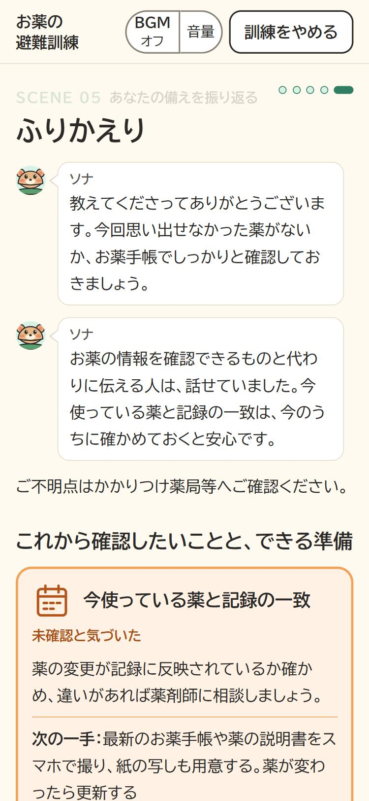

# SonaQuest（ソナクエスト）

**備える ＋ クエスト ＝ SonaQuest。** ゲームのクエストに挑むような気軽さで、「お薬の避難訓練」ができる Web アプリです。

- **試す**：https://sonaquest.takafumi-mizuguchi.workers.dev/ （スマートフォンとパソコンのブラウザで開けます。ログインは要りません）
- **デモ動画**（約3分。画像を押すと YouTube で開きます）

[](https://www.youtube.com/watch?v=kEnz2BS5uBw)

災害のとき、お薬手帳もスマートフォンも手元に無い場面で、自分の飲んでいる薬をどう伝えますか。

- 発災翌日の避難所の救護所の受付で、係のソナに普段の薬のことを聞かれる場面を、約5〜10分の対話で体験します。文字で答えるか、自分の声で答えるかを選べます。
- 答え終わると、5つの観点ごとに、伝えられたこと・まだ備えが足りないところが分かり、次にやる準備を1つ選んで終わります。
- 薬の中身は架空の内容で答えます。アプリは薬の正しさを判断せず、会話を保存しません。
- Claude が聞き方と判定を受け持ちます。Claude が作った文は、検査と別の Claude の確かめを通ってから画面に出ます。
- 訓練の外に、地域本部が各救護所の医薬品の状況を見るボード（架空データのデモ）もあります。



振り返りの画面（スマートフォンの幅。2026-11-11 に公開環境で、架空の回答で最後まで通したもの）

防災訓練のように、前もって一度やっておくことで、いざというときに慌てずに伝えられるようにすることを目指しています。

> **これは医療サービスではありません。** 薬の正誤の判断、服薬の助言、診断は行いません。体調に異変があるときは訓練をやめ、119番などの緊急連絡先へ連絡してください。

## 何をするアプリか
発災翌日の避難所の救護所の受付で、係のソナに服薬のことを聞かれる場面を体験します。お薬手帳やスマートフォンなど、普段頼っている情報源が使えないときに、

- 代わりにどう伝えるか
- まだ確認できていないことは何か

に気づいてもらうことが目的です。結果画面では、5つの観点（情報の在りか、代わりの手段、今の服用状況と記録の新しさ、記録に無い情報、代わりに伝えられる人）ごとに「確認できた」「未確認と気づいた」「確認していない」を示し（AIとのやり取りが途中で失敗した回は、どの観点も「判定できませんでした」と表示します）、最後に準備行動を1つと、いつやるかを選びます。実際の救護所の聞き取りに合わせて薬の名前や量も尋ねますが、答えは入力したまま表示するだけで、正しいかどうかの判定も記録もしません。薬の中身（名前・量・病名など）は架空の内容で答え、どこに記録があるか、ほかにどう伝えるか、薬を知っている人は、自分のこととして振り返ります。伝える準備を振り返り、復習してしっかり覚えるきっかけにしてもらうことを目指しています。思い出せなかったことは、その場で実際のお薬手帳や薬の袋を確認するよう促し、アプリが候補を示すことはしません。

## 医療従事者の視点（架空データのデモ）
SonaQuest の中心は、患者の立場で練習する「お薬の避難訓練」です。それに加えて、訓練の外の画面として、地域本部の医薬品ボード（架空データのデモ）を置いています。医療従事者の立場から、災害時の患者対応と薬剤供給の情報共有を模擬体験し、医療者の側でも災害への備えを考えるきっかけにしてもらうことを狙っています。効果はまだ確かめていません。

- **狙い**：災害時の本部では、各救護所からの患者人数や薬の不足の報告を、本部のホワイトボードに書いて共有していた、という聞き取りがあります（一般化して書いています）。ボードでは、その報告が各救護所から本部へ届く形を画面で見せます。
- **今あるもの**：救護所ごとの不足・在庫・経路の一覧、架空の町の模式図、架空の問診の入力（カルテ）、デモ時計で在庫と需要が動くこと、発注の提案と人による承認です。すべて架空のデータで、Claude・API・保存は使いません。中身は下の「提出時点」の表の「地域本部の医薬品ボード」の行に書いています。
- **本部と救護所の掲示板チャット**：本部と救護所A〜Dの役を Managed Agents のエージェントが演じ、薬剤以外の連絡だけをやりとりします。Claude に作らせるのは薬剤以外の連絡文だけで、検査を通らない文は固定の掲示に替えます。手元では本物の Managed Agents で動くことを確かめました。公開環境にもデプロイしていますが、公開の画面で動くことは確かめていません。
- **架空の患者100人の到着**：架空の患者がルールと種付きの乱数で救護所に着き、服薬の品目の在庫が減ります。Claude も API も使いません。けがの重さ・緊急度・処置は判断しません。
- **構想**：次の2つは実装していません。問いと整理は [docs/roadmap.md](docs/roadmap.md) の12・13に書いています。
  - レセプト請求のための情報のエクスポート（検討中・未実装）。
  - 薬剤の需要の見込みを Claude で説明すること（将来構想。需要の数は Claude に作らせません）。
- **救護所ごとの権限とカルテの確認（デモ用）**：ボードに入るときに、救護所（A〜D）と架空の担当者を選ぶデモ用のログインがあります（パスワードなし）。自分の救護所のカルテだけを編集でき、ほかの救護所は「閲覧のみ（救護所Bの記録）」のように文字で示します。書き込みの前に Worker（`/api/board/authorize`）へ、ログイン中の救護所・書き込み先の救護所・出来事の種類の3つだけを送って確かめ、違えば 403 で拒みます（カルテの中身・氏名・担当者名は送りません）。カルテには「AI下書き → AI監査中 → 監査済み（指摘あり／指摘なし）または監査できず → 人が確認済み」の状態があり、監査で指摘が無くても人が確認するまで確定しません。カルテの要約は、架空の会話の見本から抜き出す形（抽出型）で作り、コードでの確認と Managed Agents の監査役の2段で確かめます。監査役のエージェント（Managed Agents、Claude Opus 5.5）は作成し、公開環境にもデプロイしました。公開の画面で監査が動くことは確かめていません。ログイン・カルテを開いた・権限がなく拒んだ、などのアクセス記録は画面の端の一覧に出し、保存しません。
  - **限界**：デモ用で、本人確認をしていません。画面が送る救護所の値を Worker がそのまま信じるので、偽装は簡単です。本番の権限の仕組みではありません。開発用サーバーだけで動かすとき（Worker が無いとき）は、画面側の判定だけで進めます。本部（HQ）としてもログインでき、発注の提案の承認・却下は HQ だけが押せます。
- ボードは医療判断をしません。薬の正誤、代わりの薬、量の妥当性、処方を判断せず、実在の患者の情報も扱いません。

## Claudeの役割
- する：聞き取りのゴール（今の薬をすべて、アレルギー・合わなかった薬、情報の在りか、代わりの手段、記録の新しさ、代わりに伝えられる人）に向かって、次に聞くことを閉じた一覧から選ぶこと（アプリが決まりで確かめ、合わなければ決まった順番の質問に戻す）、その質問の言い回しと、受け止めの一言、曖昧な回答への聞き返し、関係のない話の後の質問し直し、5観点それぞれの判定、振り返りに添える一言（観点の名前と決まった言い回しで書く。検査と監査役を通る）
- しない：聞く項目や順番を決めること、薬剤名・用法・用量・病名の推定、医療的な正誤判定、服薬の助言、診断、緊急度の判断、利用者の発言の要約・言い換え
- 想定外の出来事は、Claudeではなく固定のルールで選びます。Claudeの出力はサーバー側で形と値を検証し、Claudeが作った文は長さ・禁止表現・利用者の言葉の繰り返しを検査して、通らなければ固定文に戻します（検査は完全ではありません）。

## 提出時点
- 開発期間：2026-11-02 12:00 JST 〜 提出まで（Built with Claude: Japan 2026）
- 提出タグ：`submission-v1`。**タグまでの内容は、すべてこの期間中に新しく作ったものです。**
- コードはすべてClaude Codeで書いています。経緯は [docs/KEEP-THINKING.md](docs/KEEP-THINKING.md)、判断の理由は [docs/decisions.md](docs/decisions.md)（ADR）、進み具合は [docs/STATUS.md](docs/STATUS.md) に、Issue・PR の番号つきで残しています。

| 範囲 | 状態 |
|---|---|
| 文字入力での対話（最大10回） | 実装済み：固定の質問で進める。Claude が次に聞くゴールを選ぶ経路と、言い回し・聞き返し・質問し直しの経路も実装。本物の Claude で、ゴールを選ぶ形を含めて 2D・3D を最後まで通した（2026-11-07）。③確認の情報源は絵と文字のカードで選ぶ |
| 2D／3D の選択 | 実装済み：はじめにの画面で選ぶ（既定は 2D）。2D と 3D のそれぞれで1問目まで進むことを確かめた |
| ソナの見た目 | 3D：パペット（three で描く）を実装し、見本のページと訓練の中（はじめから終わりまで、Claude を呼ばない状態）で確かめた。WebGL が使えないときや動きを減らす設定では 2D の姿に戻り、声はそのまま使える（差し替えで確認）。2D：パペットの 2D 版の姿（SVG と CSS） |
| Claudeによる聞き返し・判定 | 実装済み（Cloudflare Workers の `/api/turn`）。Claude の作った文は、検査の後に別の Claude の呼び出し（監査役）でも確かめる。開発用サーバーと `wrangler dev` で、本物の Claude を使って 2D・3D を通した（2026-11-06・11-07）。公開環境でも 2D を Claude ありで最後まで通した（2026-11-07）。固定の質問だけの方式との比較実験はまだ |
| 想定外の出来事 | 実装済み：本人の確認とルールによる選択。出来事の場面では、使えなくなったものを絵・斜線・「（使えない）」で示す。出来事ごとの専用の絵、後半の情報源の並びと場面の点の動き、BGM（初期はオフ）も取り込み、Claude を呼ばない状態の通しで確かめた（2026-11-05）。動きの見た目と BGM の音そのものは、まだ人が確かめていない |
| 結果画面と準備行動の選択 | 実装済み：回答の原文（出来事の前後）と準備行動の選択。手薄なところ・使えなくなったもの・準備行動を絵と文字で示す。振り返りに、オーナーが確認した公的資料へのリンクを出す（出典は [docs/references.md](docs/references.md)） |
| 緊急時の中断 | 「訓練をやめる」ボタンと、体調の訴えらしい入力の語の照合による自動の中断を実装（自傷のほのめかしには別の案内）。語の一覧と案内の文面はオーナーが確認した。すべての訴えを見分けられるわけではない |
| API失敗時の固定質問での進行 | 実装済み。失敗・時間切れ（15秒）・形の違う出力では、その回の残りを固定の8問で進める。Workers を動かさない開発用サーバーと、Claude を呼ばない状態の試しのデプロイで、失敗から最後まで進むことを確かめた |
| 音声認識・音声合成 | 3D の対話モードで使う（2D は文字で答える）。はじめにの画面で、「文字で答える」（2D）か「自分の声で答える」（3D。読み上げも聞ける）を選ぶ（既定は 2D）。「押して話す」（ブラウザ標準の Web Speech API）で答え、認識した文は入力欄で直してから送る。ソナの文は ElevenLabs で読み上げ（Workers の `/api/tts` 経由。`/api/turn` と同じく、手元からか公開の切り替え `PUBLIC_TURN=1` のときだけ）、失敗したらブラウザの読み上げに切り替える。手元の開発用サーバーで、ブラウザの読み上げへの切り替えと、マイクを使えないときの文字入力を確かめた。ElevenLabs の本物の読み上げも手元で確かめた（押してから声が出るまで 2.4秒、1回）。公開環境で、ElevenLabs の声とマイクの認識が動くことをオーナーが実機で確かめた（2026-11-07） |
| 地域本部の医薬品ボード（架空データ） | 実装済み（架空データだけ）：はじめにの画面から入る、訓練の外の画面。画面の題は「SonaQuest」と副題「各救護所の状況」。左のペインに本部（HQ）→ 架空の地区 → 救護所（在庫切れ・薬剤師の不足・未交付などの短い印）、右は上部タブ（全体／在庫／発注・搬送／記録（カルテ）／デモ）。PC ではページ全体をスクロールせず、ペインとタブの中でスクロールする。本部の全体に架空の町の模式図（SVG。本部と救護所、本部からの経路の通行可・迂回・通行止め、拠点の不足の印、本部の周りの状況、最新情報。外部の地図は使わない）と、救護所ごとの「確認・手配が必要な品目」。ペインか図の拠点を押すと救護所の詳細（不足薬：どこで・何が・どれだけ不足し・次に何を確認するか、在庫切れ・未確認・見込み算出不可を分ける。患者人数、架空の連絡先、経路、通信、カルテ）。デモとして、救護所のカルテに架空の問診（架空の氏名）を登録すると在庫と未交付が動き、在庫の算数で**発注の提案**（必要な数量と、本部備蓄から出せる分・卸へ頼む分。内訳を表示）が出て、本部で人が**承認**すると本部の在庫を引き当てて搬送が載り、デモ時計を進めると搬送中 → 受領で現地の在庫が増える（ブラウザのメモリだけ。保存・送信なし。薬の中身・代わりの薬・量の妥当性は判断しない）。Claude・API・保存は使わない。振り返りには「救護所に渡す記録の形」（回答を原文のまま項目に並べる。要約なし）を足した。本部（HQ）でログインすると、記録（カルテ）のタブで、架空の患者を演じて話す見本を音声認識で文字にできる（ブラウザ標準の音声認識。マイクの前に、ブラウザによって音声が事業者に送られることと、架空の内容だけを話すことを出す。文は直せる欄にメモリだけで持ち、保存なし。カルテには書き込まない）。その文字起こしから、本人の言葉を1文字も変えずに引用した抽出型の要約を作れる（送る前に送り先と「架空の内容だけ」を出し、押したときだけ Workers を通して Claude に送る。引用が文字起こしにあるか・数字や名前が足されていないか・禁止表現をコードで確かめ、確定は人）災害時の問診モード（実際の患者の記録）と外部の地図を使う表示は将来構想で、説明の文だけ |

公開環境（Cloudflare Workers）にデプロイしています：https://sonaquest.takafumi-mizuguchi.workers.dev/ 。公開環境でも Claude を呼びます。Claude とのやり取りが失敗したときや時間切れのときは、固定の質問で最後まで進みます。デプロイはそのつどオーナーの承認を得て行い、記録は docs/STATUS.md にあります。

## Claude の使い方
目的ごとにモデルと仕組みを分けています（中身は `video/src/modelMap.ts` の表と、各ファイルの定数）。

| どこで | モデル・仕組み | 何をするか | 確かめ |
|---|---|---|---|
| 訓練の聞き取り係 | Claude Opus 5.5（`web/worker/claude.ts`）、構造化出力 | 次に聞くゴールの選択、質問の言い回し、受け止め・聞き返し、5観点の判定、振り返りの一言 | Workers の検査（禁止の言葉・長さ・繰り返し）を通らなければ固定文に戻す |
| 訓練の監査役 | Claude Haiku 5.5（`web/worker/audit.ts`） | 検査を通った文を、画面に出す前にもう一度確かめる。利用者の回答は送らない | 出してよい文 12/12・止めるべき文 18/18（3回。[docs/evidence.md](docs/evidence.md)） |
| ボードの掲示板チャット | Managed Agents ×5（Claude Opus 5.5、`web/worker/boardChatAgents.ts`） | 本部と救護所A〜Dの役で、薬剤以外の連絡だけをやりとりする | 掲示板専用の検査を通らなければ固定の掲示に替える |
| ボードのカルテ | 要約：Claude Sonnet 5.5（`web/worker/karteSummary.ts`）、監査：Managed Agents（Claude Opus 5.5） | 架空の会話の見本から、本人の言葉を写した抽出型の要約を作り、別のモデルが発言との食い違いを確かめる | コードでの確認 → 別のモデルの監査 → 最後は人が確かめる |
| 開発 | Claude Code | 設計・実装・試験・審査。コードはすべて Claude Code で書いた | hook（`.claude/hooks/`）と Skill（`.claude/skills/`）で決まりを守り、Issue → ブランチ → PR で進めた |

## Yorukusuとの関係
SonaQuestは、制作者が以前のハッカソンで作ったYorukusuとは別の、この期間中に新しく作った作品です。Yorukusuのコード、Skill、データは使っていません（経緯は [docs/decisions.md](docs/decisions.md) の ADR-0002）。
<!-- → オーナー決定（2026-11-06、チャット）：1〜2文に縮める。 -->
<!-- オーナー（2026-11-02）：保留。この文面を見てから判断する。 -->

## 着想を得た作品
3D のパペット（形をコードで組み、話している間に口を開け閉めする）と音声のやり取りは、[rhmoller/virtual-puppet-theater](https://github.com/rhmoller/virtual-puppet-theater)（MIT）から着想を得ました。考え方だけを参考にし、コードは使っていません（[docs/decisions.md](docs/decisions.md) の ADR-0005）。

## 入力していただく内容
このアプリは、災害時の服薬情報の伝え方を練習するものです。入力した内容は、会話を進めるためにAIサービス（Anthropic）へ送られます。氏名、住所、電話番号などは入力しないでください。あなたやほかの人の実際の服薬情報（薬の名前・量・病名など）は入力せず、架空の内容で練習してください。薬の正確さや治療の適否は判定しません。

## プライバシー
「保存しない」と「外部に送らない」は別のことです。このアプリは保存しませんが、回答の文字は、判定と会話の進行のために外部事業者へ送られます。3D の対話モードで声で答えると、声も、文字にするためにブラウザが使う音声認識のサービスへ送られます。

### このアプリの方針（保存）
- ログインはありません。会話本文、録音、文字起こしを、このアプリのデータベースやログに保存しません（データベースを持ちません）。読み上げの音声は、その回のあいだブラウザのメモリにだけ持ち、保存しません。
- 結果画面に出す「あなたの回答」は、端末内に保持した入力そのものです。AIが書き直したものではありません。
- 結果画面の「確認できた」は、その点を説明できたという意味です。内容が正しいことや、実際にその薬を飲んでいることを確かめたものではありません。
- APIキーはサーバー側（Cloudflare Workersのsecrets）にだけ置きます。

### 外部事業者に送るもの
回答の内容は、処理のために次の外部事業者へ送られます。保持方針は各事業者のもので、このアプリの方針とは別です。

| 送信先 | 送るもの | 事業者の保持方針（公表内容。確かめた日は行ごとに書く） |
|---|---|---|
| Anthropic（Claude API） | 回答の文字と、画面に出した質問の文（AIが作った言い回しを含む）、出来事・選んだ情報源などのアプリの固定文（回答のたびに、それまでの回答をまとめて送る。関係のない話として質問し直した入力は、その後は送らない）。AIが作った文は、画面に出す前に、その文と固定の質問の文だけをもう一度送って確かめる（監査役。回答は送らない） | 入出力は30日以内に削除（例外あり）。明示の許可なく学習に使わない（2026-11-02 確認）。このアプリはゼロ保持の契約を結んでいない |
| ブラウザが使う音声認識のサービス（3D の対話モードで、声で答えたときだけ） | あなたの声（文字にするため） | ブラウザによって違う（2026-11-04 確認）。Microsoft Edge：Microsoft の Azure Cognitive Services へ送り、録音は保存しない（[Microsoft Edge のプライバシーの説明](https://learn.microsoft.com/en-us/legal/microsoft-edge/privacy)）。Safari：Apple へ送られ、「Siri と音声入力の改善」に同意していなければ音声は保存しない（[Apple](https://www.apple.com/legal/privacy/data/ja/ask-siri-dictation/)。Safari のページの音声認識にこの説明が当てはまるかは未確認）。Google Chrome：Google のサービスと見られるが、送信先と保持方針を Google の一次資料で確かめられなかった（未確認）。MDN は、Chrome などでは音声が認識のために Web サービスへ送られると書いている（[MDN](https://developer.mozilla.org/en-US/docs/Web/API/SpeechRecognition)） |
| ElevenLabs（3D の対話モードの読み上げ） | 画面に出したソナの文（固定文、または検査と監査役を通った AI の文）と、③確認・出来事などの固定文。あなたの回答と声は送らない | 生成した音声と文を既定で履歴に残す（ゼロ保持は Enterprise のみ。[ElevenLabs のゼロ保持の説明](https://elevenlabs.io/docs/eleven-api/resources/zero-retention-mode)）。入出力をモデルの学習に使い、利用者（このアプリの運用者）は設定で断れる。データは米国に移して保存する（[ElevenLabs のプライバシーポリシー](https://elevenlabs.io/privacy-policy)、2026-10-09 更新）。2026-11-04 確認。このアプリはゼロ保持の契約を結んでいない |

詳細は初回画面に表示します。

## 安全と限界
- 医療サービスではありません。薬の正誤の判断、服薬の助言、診断、薬の備蓄量の助言をしません。
- 画面の「訓練をやめる」ボタンで、いつでも中断できます。体調の訴えらしい入力では、まず「現在の体調の訴えでしょうか？」と確かめ、「はい」のときに訓練を中断して固定の案内を表示します（自傷のほのめかしは確かめずにすぐ中断します）。ただし、すべての訴えを検出できるわけではありません（語の照合で見分けるため、方言・遠回しな言い方・音声認識の誤変換を見逃すことがあります。docs/safety-test-plan.md E7）。アプリは症状の緊急性を判断しません。
- 公的制度に触れる場合は、確認済みの固定文と出典だけを表示します（[docs/references.md](docs/references.md)）。
- 音声認識の結果は、実際の発話と一致しないことがあります。
- **デモに登場する人物と情報は、すべて架空です。** 実在の患者情報はデモにもテストにも使っていません。

## 参考にした公式資料（聞き取りの流れと質問の文言）
ソナの質問は、次の公的な手引きにある聞き取りの項目と順番を参考に、SonaQuest用に書き起こしました。患者にそのまま話しかける質問の台本は、どの資料にもありません。資料の原本はリポジトリに入れていません（参照日 2026-11-03）。

| 発行元・資料（年） | 参考にした点 |
|---|---|
| 東京都保健医療局「[災害時薬事活動ガイドライン（第2版）第3章](https://www.hokeniryo.metro.tokyo.lg.jp/documents/d/hokeniryo/2025-03-17-184044-208)」（2025） | 救護所の入口で、診察の前に普段の薬を聞き取る流れ（p.50）。手帳・マイナポータルの併用（p.52） |
| 厚生労働科学研究 研究班「[改訂版 薬剤師のための災害対策マニュアル](https://www.mhlw.go.jp/content/001438348.pdf)」（2024、厚生労働省掲載） | 救護所では1人約3分で常用薬の希望を聞く（薬事トリアージ）。災害処方箋（案）の確認欄（定期の服用、中断、アレルギー） |
| 宮城県「[災害時薬事関連業務マニュアル 第5版 第2章](https://www.pref.miyagi.jp/documents/28096/02iryokyugokatudo.pdf)」「[第7章](https://www.pref.miyagi.jp/documents/28096/07okusuritetyo.pdf)」（2024） | 普段の薬・アレルギー歴・副作用歴を聞く。服用歴が分からなくてもアレルギーと副作用は確かめる（p.11）。手帳・薬袋・薬歴が代わりの手がかりになる |
| 日本薬剤師会「[東日本大震災時におけるお薬手帳の活用事例](https://nichiyaku.or.jp/files/co/activities/shinsai_techo.pdf)」（2012） | 薬効の言い方でしか伝えられなかった例、残っている薬との照合、家族や介護者が気づいた例 |
| 厚生労働省「[令和6年能登半島地震 災害時モード活用事例](https://www.mhlw.go.jp/content/001203369.pdf)」（2024） | 持ってきた薬のほかに飲んでいる薬の確認、いつから飲んでいるかの確認、名前が分からなくても薬の情報を確かめられた例 |
| 厚生労働省掲載・国立長寿医療研究センター「[持参薬評価表（様式07）](https://www.mhlw.go.jp/content/11120000/001277322.docx)」（2024、[通知ページ](https://www.mhlw.go.jp/stf/newpage_41542.html)） | 手帳を「持っている（今ある）／持っている（今ない）」で分ける。市販薬・サプリ、副作用歴、アレルギー歴、薬を誰が管理しているか、かかりつけ薬局 |
| 厚生労働省「[避難所生活を過ごされる方々の健康管理に関するガイドライン](https://www.mhlw.go.jp/bunya/kenkou/dl/guideline_110606.pdf)」（2011） | 薬を飲み続けられているかの確認。家族と離れたときに備えた処方薬のメモ |
| 厚生労働省「[高齢者の医薬品適正使用の指針（総論編）](https://www.pmda.go.jp/files/000224395.pdf)」（2018、PMDA掲載） | 受診しているすべての医療機関と、市販薬・サプリを把握する。家族などから服薬状況を聞く |
| 日本病院薬剤師会「[薬剤師の病棟業務の進め方 Ver.1.2](https://www.jshp.or.jp/activity/guideline/20160609-2.pdf)」（2016）、「[ポリファーマシー対策の進め方 Ver.2.1](https://www.jshp.or.jp/activity/guideline/20240415-1-1.pdf)」（2024） | 持参薬に加えて市販薬・健康食品・アレルギーまで聞く。情報源（手帳、手帳アプリ、マイナ保険証など）の確認 |
| 練馬区・練馬区薬剤師会「[災害時における練馬区薬剤師会活動マニュアル](https://www.city.nerima.tokyo.jp/kurashi/bosai/jishinsonae/disastermedical/saigaiiryoukankeisya.files/yakuzai.pdf)」（2016、2018一部修正） | 聞き取り項目の並び（申し出、症状、服薬履歴、アレルギー）と口調 |
| 厚生労働省「[電子処方箋の普及拡大に向けた取組について](https://www.mhlw.go.jp/content/10800000/001674531.pdf)」（2026） | 直近の薬の情報は患者の記憶と手帳に頼ること（p.3）。災害時モード（p.10〜11） |

- SonaQuestは実際の聞き取りと違い、症状（主訴）を聞かず、答えの正しさや緊急度を判定しません。
- 資料に載っている実在の人物の名前や、事例に出てくる薬の名前は、このリポジトリに書いていません。

### ボードの外部リンク
地域本部の医薬品ボード（架空データ）の、本部の「在庫」タブにだけ、次のページへのリンクを置いています。押したときに新しいタブで開くだけで、ページの内容の取得・取り込みはしていません。ボードの在庫の数字は、すべて架空データです。

| 発行元・題 | URL | 確認日 | 画面に添える文 |
|---|---|---|---|
| 厚生労働省「国の医薬品供給状況」 | https://www.mhlw.go.jp/stf/seisakunitsuite/bunya/kenkou_iryou/iryou/kouhatu-iyaku/04_00003.html | 2026-11-06 | メーカーの出荷状況です。救護所の在庫ではありません |

## 免責
SonaQuestは防災訓練のためのアプリであり、医療機器でも医療サービスでもありません。服薬や体調に関する判断は、医師・薬剤師にご相談ください。緊急時は119番へ連絡してください。

## 開発環境
- 必要なもの：Git、Python 3.9以上（Claude Codeのhookとコミット前フックで使用）、Node.js（LTS版、v22以上。アプリの実装で使用）
- クローン後に一度だけ：
```bash
git config core.hooksPath .githooks
```
- hookの試験：
```bash
sh .claude/hooks/run-python.sh .claude/hooks/test_hooks.py
```

### アプリを動かす（`web/`）
- 依存を入れる（初回だけ）：
```bash
npm --prefix web install
```
- 開発用サーバーを起動する（http://localhost:5173 で開く）：
```bash
npm --prefix web run dev
```
- Claude とつなぐときは、秘密情報の雛形を写して、値を入れる。このリポジトリで使うキー（`ANTHROPIC_API_KEY`、読み上げの中継で使う `ELEVENLABS_API_KEY`・`ELEVENLABS_VOICE_ID`）は、雛形にすべて書いてある。写した `web/.dev.vars` は Git に入れない（`.gitignore` 済み）：
```bash
cp web/.dev.vars.example web/.dev.vars
```
- 別のターミナルで Workers も動かす（`/api` は http://127.0.0.1:8787 へ渡る）。Workers を動かさないときは、最初の回答で失敗し、固定の質問で最後まで進む：
```bash
npm --prefix web run dev:worker
```
- `wrangler dev` は workerd を使う。npm が workerd のインストール時のスクリプトを止めたときは、オーナーが中身を確かめて許可する（Claude Code は許可しない）
- Workers は、手元からの呼び出しのときだけ Claude を呼ぶ。公開する版で Claude を使うには、回数制限と支出の上限（docs/safety-test-plan.md P7・P9）を満たした後に、Workers の設定で `PUBLIC_TURN=1` を入れる（デプロイと設定はオーナーの承認の後）
- 読み上げの中継（`/api/tts`、ElevenLabs）も、同じ `PUBLIC_TURN=1` で公開の宛先から使えるようになる（2026-11-04 オーナー決定、ADR-0033）。そのときは接続元ごとの回数制限（ADR-0035）を通し、別のサイトのページからの呼び出しは拒む。ElevenLabs が使えないときは、画面がブラウザの読み上げに切り替える。ElevenLabs のアカウントには、オーナーが使用量の上限を設定した。上限に達したときも、画面はブラウザの読み上げに切り替える
- 3D の対話モード（押して話す・読み上げ）は、はじめにの画面で「自分の声で答える」を選ぶ。http://localhost:5173/?mode=3d を開くと、最初の表示だけ 3D が選ばれた状態になる（選び直せる。「はじめに戻る」で戻ると既定の 2D）
- Workers のまとめ（デプロイはしない確かめ）：
```bash
npm --prefix web run bundle:worker
```
- 単体試験と型の検査：
```bash
npm --prefix web test
```
```bash
npm --prefix web run typecheck
```

## リポジトリの構成
```
CLAUDE.md              Claude Codeが毎回読む短いルール
.claude/rules/         スコープ・安全・プライバシー・GitHub運用の詳細
.claude/skills/        session-handoff / safety-review / judge-audit / dev-log
.claude/hooks/         TODO-OWNERマーカーの保護、秘密情報の検出、mainの保護、その試験
.githooks/             gitのフック（コミット前の検査、mainへのコミットの防止）
docs/                  PRD、構成、判断の記録、進捗、日誌、試験計画、証拠、出典
docs/roadmap.md        提出後の課題（提出版の実装には含まない）
docs/dev-logs/         テーマごとの開発記録（経過と教訓）
docs/reviews/          外部レビュー・助言の記録（何を聞き、何を言われたか）
web/                   画面（React / TypeScript / Vite）。src/flow/ に進行のルールと固定文
web/src/brand/         ロゴ（文字を図形にした SVG と部品。アプリと動画が読む）
web/worker/            Cloudflare Workers（Hono）の /api/turn・/api/tts。Claude の呼び出しと、出力・文の検査、監査役、読み上げの中継
web/experiments/       モデルの比較実験の材料（架空の回答）と実行の台本、測った値
video/                 提出動画（Remotion）。場面の表、ナレーションの原稿、BGM・効果音の合成。録画・音声は Git の対象外
```

## 制作者
<!-- オーナー決定（2026-11-02）：Guttyo と GitHub へのリンクだけを載せる。 -->
<!-- オーナー決定（2026-11-06、チャット）：本名も入れ、「水口貴史(@Guttyo)」とする。 -->
水口貴史（[@Guttyo](https://github.com/Guttyo)）

## ライセンス
<!-- オーナー決定（2026-11-02）：MITを基本とする。外部素材（キャラクター等）は個別に利用条件を確認する。LICENSE ファイルはマーカー解除後に追加する。 -->
MIT（[LICENSE](LICENSE)）。外部素材を使う場合は、それぞれの利用条件に従います。

ロゴの文字は、書体 Manrope（Copyright 2018 The Manrope Project Authors、SIL Open Font License 1.1）の字形を図形にしたものです。フォントファイルは含みません（`web/src/brand/README.md`）。
